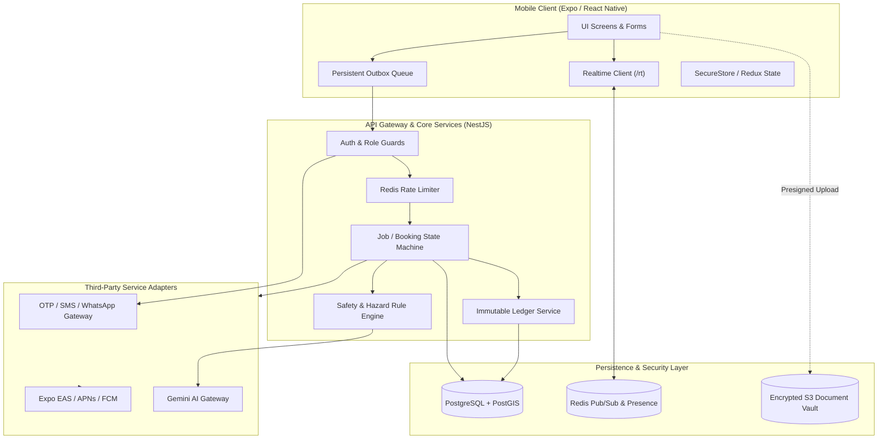
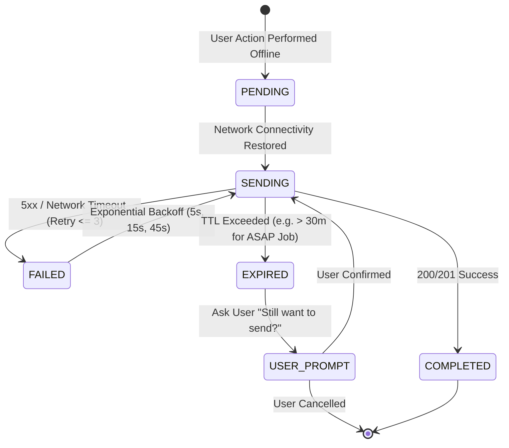
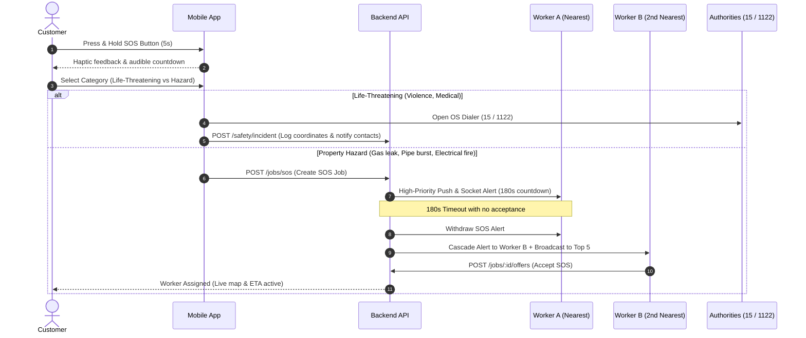
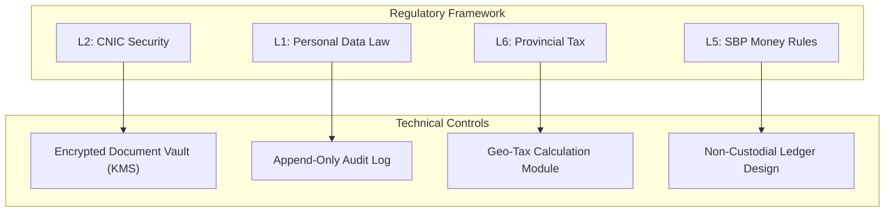
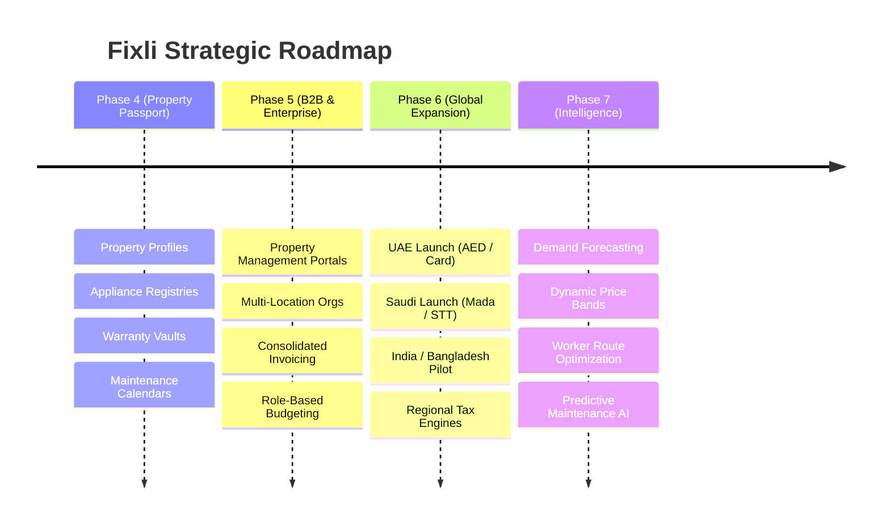

# Fixli — Master Plan for All Pending Items & Edge Cases

> **Target Version:** Production Release 1.0 (Pakistan Pilot) & Beyond  
> **Status:** Comprehensive Implementation & Operational Plan  
> **Governing Specifications:** Docs 00–25, System Architecture, Legal Framework  

---

## Executive Overview & Architectural Principles

This document is the **single exhaustive master plan** addressing every pending item, open decision, deferred feature, operational requirement, and regulatory gate across the Fixli documentation suite.

Every pending item in this plan is designed around **six zero-tolerance principles**:
1. **Zero Silent Failures:** Every network, background, payment, or state failure must have deterministic client recovery, an audit record, and explicit user-facing messaging.
2. **Financial Immutability:** Money is calculated strictly in integer minor units (PKR paisas). Balances derive exclusively from append-only ledger entries; updates or deletes are architecturally forbidden.
3. **Data Minimization & Isolation:** Sensitive assets (CNIC images, exact addresses, voice recordings, phone numbers) are access-controlled with expiring signed URLs, role-gated queries, and strict progressive disclosure.
4. **Offline First with Expiry Guard:** Local mutations queue in a transactional SQLite/AsyncStorage outbox, guarded by idempotency keys and strict Time-To-Live (TTL) envelopes to prevent stale executions.
5. **Deterministic State Transitions:** State changes occur strictly via server-side state machines with optimistic concurrency locks (`WHERE id = ? AND status = ?`).
6. **Graceful Degradation:** When AI, telecom SMS, or cloud push fails, the system immediately degrades to deterministic rule engines, WhatsApp fallbacks, and in-app polling.



---

## Track 1: Technical & Engineering Items (Detailed Specs & Edge Cases)

### 1.1 Phone Verification & OTP Authentication (`O5`, `D9`, Phase 2 Residual)

#### A. Architecture & Provider Abstraction
Replace the deferred temporary login flow with a multi-channel OTP provider interface:
```typescript
export interface OtpProvider {
  sendOtp(phone: string, code: string, channel: 'WHATSAPP' | 'SMS'): Promise<{ messageId: string }>;
  verifyCode?(phone: string, code: string): Promise<boolean>;
}
```
* **Primary Channel (Pakistan):** WhatsApp Business API via Infobip or Twilio.
* **Secondary Fallback:** Direct domestic SMS gateway (Telecard, Telenor, or Jazz Business SMS API) with registered alphanumeric Sender ID (`Fixli`).

#### B. End-to-End Flow & State Machine
1. User enters phone number formatted via `PhoneField` (validated to E.164: `+923XXXXXXXXX`).
2. `POST /auth/phone/start` generates a cryptographically secure 6-digit numeric token (`crypto.randomInt(100000, 999999)`).
3. Token is hashed with salt (`bcrypt` cost 10) and stored in `PhoneVerification` table with:
   * `expiresAt = now() + 10 minutes`
   * `attemptsRemaining = 5`
   * `cooldownUntil = now() + 60 seconds`
4. Client enters countdown timer (60s). If timer expires without receipt, UI enables "Resend via SMS" (if WhatsApp was tried first) or "Resend via WhatsApp".
5. Upon entry, `POST /auth/phone/verify` checks hash. If matched, sets `consumedAt = now()` and returns a signed, single-use `signupToken` (JWT, 15 min expiry, payload `{ phone, purpose: 'SIGNUP' }`).
6. `POST /auth/signup` consumes `signupToken` atomically to create the account.

#### C. Edge Cases & Exhaustive Mitigations
* **SIM Recycling / Number Reassignment:**
  * *Scenario:* Previous owner of `+923001234567` had an account. New SIM owner tries to sign up.
  * *Mitigation:* If phone number is verified via OTP, but already exists in `User`:
    * If account has been dormant (> 180 days with no active jobs or funds), prompt user: *"An existing account is linked to this number. Is this a new SIM?"*
    * If confirmed, quarantine previous account (anonymize identity, archive ledger records) and initialize a brand-new clean profile for the verified owner.
    * If account has recent activity, lock login and require secondary verification or customer support review to prevent takeover.
* **Brute-Force & Enumeration Attacks:**
  * *Attack:* Attacker cycles OTP guesses on an active phone session.
  * *Mitigation:* Hard limit of 5 failed attempts per `PhoneVerification` record. On the 5th failure, invalidate the record immediately. Enforce IP + Phone rate limit in Redis (max 3 verification requests per phone per hour). Constant-time comparison to prevent timing side-channels.
* **Telecom Delays & Spam Filtering:**
  * *Scenario:* Telco delays SMS delivery by 3–8 minutes.
  * *Mitigation:* OTP validity is 10 minutes. Client UI displays: *"Codes can take up to 2 minutes during peak hours"*. Cooldown allows channel toggle (WhatsApp $\leftrightarrow$ SMS) after 60s.
* **App Process Death Mid-Flow:**
  * *Scenario:* User switches to WhatsApp/SMS app to copy OTP; mobile OS terminates Fixli to free RAM.
  * *Mitigation:* App caches `{ phone, purpose, expiresAt, step: 'OTP_PENDING' }` in `AsyncStorage`. On resume, `app/_layout.tsx` checks local draft state and restores user directly to the OTP input screen with active countdown.
* **Concurrent Signups on Same Number:**
  * *Scenario:* Two devices attempt to verify the same phone simultaneously.
  * *Mitigation:* Database partial unique index on `PhoneVerification(phone)` where `consumedAt IS NULL`. Issuing a new OTP automatically revokes all prior unconsumed codes for that phone.

---

### 1.2 Offline Resilience & Deterministic Outbox Queue (`O2`, Phase 4 Residual)

#### A. Architecture
A transactional outbox queue implemented in React Native mobile client using SQLite/WatermelonDB/AsyncStorage:
```typescript
export interface OutboxItem {
  id: string; // Client UUID
  endpoint: string;
  method: 'POST' | 'PUT' | 'PATCH';
  payload: any;
  createdAt: number;
  validUntil: number; // TTL timestamp
  retryCount: number;
  status: 'PENDING' | 'SENDING' | 'FAILED' | 'EXPIRED';
  idempotencyKey: string;
}
```

#### B. Execution Loop & State Transitions


#### C. Edge Cases & Exhaustive Mitigations
* **Stale ASAP Service Requests:**
  * *Scenario:* Customer creates an urgent plumbing request while in a basement without cellular reception. The phone regains signal 4 hours later. Automatically dispatching workers 4 hours later leads to severe customer dissatisfaction and wasted worker transit.
  * *Mitigation:* `validUntil` envelope:
    * For `urgency === 'EMERGENCY'` or `'ASAP'`: TTL is strictly 20 minutes.
    * For `scheduled` jobs: TTL is up to 24 hours (or scheduled time minus 2 hours).
    * When `now() > validUntil`, outbox suspends auto-send, surfaces a high-priority system modal: *"You created a request for Plumbing at 2:15 PM while offline. Would you still like to post it?"* with **[Send Now]** and **[Discard]** actions.
* **The "Lost Response" Illusion (Duplicate Execution):**
  * *Scenario:* The client sends `POST /jobs`, the server inserts the job into the database, but cell connection drops before the HTTP 201 response reaches the phone. The client marks the call failed and retries on reconnect.
  * *Mitigation:* Every mutating request carries an `Idempotency-Key: <UUID>` generated when the outbox item is first queued. NestJS backend `IdempotencyInterceptor` caches responses in Redis for 24 hours keying on `idempotency:<userId>:<key>`. The retry returns the original cached response with `X-Cache: HIT-IDEMPOTENT`, preventing duplicate job creation.
* **FIFO Dependency Ordering:**
  * *Scenario:* While offline, user creates a job, attaches 2 photos, and writes a note.
  * *Mitigation:* Outbox processes items with strict dependency resolution: `uploadPresign` $\rightarrow$ `s3Put` $\rightarrow$ `jobCreate` $\rightarrow$ `chatMessage`. If an upstream step fails or is rejected (4xx validation error), all downstream dependent items are halted and marked `BLOCKED_BY_PARENT`.

---

### 1.3 Emergency / SOS System & Auto-Dispatch Cascade (`O3`, Phase 10 Residual)

#### A. Architecture & Flow


#### B. Edge Cases & Exhaustive Mitigations
* **Accidental Long-Press in Pocket:**
  * *Mitigation:* The 5-second press requires continuous screen contact with an expanding animated circle and haptic pulses. If released prior to 5.0 seconds, timer resets with zero side effects. After completion, a 10-second audible alert plays with a single-tap **[Cancel SOS - False Alarm]** button.
* **Offline Hardware Emergency:**
  * *Scenario:* Customer triggers SOS in an area with zero cellular data/WiFi.
  * *Mitigation:* App catches network failure immediately. Instead of showing a spinner or error alert, it instantly displays a high-contrast emergency screen: **"No internet connection. Tap below to call emergency services immediately"** with direct dialer buttons for **15 (Police)** and **1122 (Rescue/Ambulance)**.
* **Worker Safety at Hazard Site:**
  * *Scenario:* Worker accepts an electrical emergency job where live wires are exposed in water.
  * *Mitigation:* The worker app requires mandatory acknowledgement of safety protocol checklist before the job state transitions to `IN_PROGRESS`:
    1. *"Main power/gas shutoff located and verified OFF"* $\rightarrow$ Mandatory Checkbox.
    2. *"Protective equipment worn"* $\rightarrow$ Mandatory Checkbox.
    3. One-tap access to emergency call button on worker app header.

---

### 1.4 Communications: Masked Calling, Voice Notes & Chat (`O6`, `O7`, Phases 7 & 8 Residual)

#### A. Masked Calling & Number Privacy Architecture
* **Pre-Booking:** Phone numbers are **completely masked**. Calling is forbidden. Communication occurs exclusively via structured offers and in-app chat (if enabled).
* **Active Job:** Calling button in app triggers an encrypted WebRTC VoIP audio bridge (Twilio Voice SDK or LiveKit) or an outbound dialer proxy.
* **Post-Completion:** All direct calling bridges expire exactly **24 hours** after `job.status === 'COMPLETED'`. If customer or worker taps "Call", the app informs them: *"Calling is closed for completed jobs. Please contact support in the Dispute Center."*

#### B. Voice Note Processing & Dialect Handling
* **Specs:** 60-second hard limit, AAC/M4A format, compressed to $\le 500\text{ KB}$.
* **Transcription Pipeline:**
  1. File uploaded directly to private S3 storage via presigned URL.
  2. Backend triggers Gemini Speech-to-Text / Whisper with locale hints (`ur-PK`, `en-PK`, `ar`).
  3. Server stores both the raw audio storage key and the generated transcript.
  4. Both worker and customer receive both: worker can read the transcript OR tap to listen to the audio voice note directly.
* **Edge Case - Mixed "Code-Switching" (Urdu-English):**
  * Gemini 2.5 Flash / Whisper prompt includes custom vocabulary and context: *"Context: Home maintenance service in Pakistan. Handles Urdu, Roman Urdu, and Pakistani English repair terminology (e.g., 'geyser leak kar raha hai', 'motor trip ho rahi hai', 'bijli breaker')."*

---

### 1.5 Cash Settlement, Ledger & Financial Edge Cases (`O8`, Phase 9 Residual)

#### A. Immutable Ledger Architecture
```sql
CREATE TABLE "LedgerEntry" (
    "id" TEXT PRIMARY KEY DEFAULT gen_random_uuid(),
    "professionalId" TEXT NOT NULL REFERENCES "Professional"("id"),
    "bookingId" TEXT REFERENCES "Booking"("id"),
    "type" TEXT NOT NULL, -- COMMISSION_OWED, COMMISSION_SETTLED, ADJUSTMENT, BONUS
    "amount" BIGINT NOT NULL, -- Signed integer minor units (PKR paisas). Positive = credit, Negative = debit
    "balanceAfter" BIGINT NOT NULL,
    "currency" TEXT NOT NULL DEFAULT 'PKR',
    "idempotencyKey" TEXT UNIQUE NOT NULL,
    "metadata" JSONB,
    "createdAt" TIMESTAMP WITH TIME ZONE DEFAULT NOW(),
    "createdBy" TEXT NOT NULL
);
```

#### B. Cash Settlement Edge Cases & Mitigations
* **Discrepancy Between Customer and Worker Reported Cash:**
  * *Scenario:* Job was quoted at PKR 1,500. Worker claims customer only paid PKR 1,000 in cash. Or customer claims they gave PKR 2,000 and worker refused change.
  * *Resolution Flow:*
    1. Worker inputs: `Mark cash received: PKR 1,000`.
    2. Customer app displays: *"Worker marked cash payment of PKR 1,000. Do you confirm?"*
    3. Customer selects **[Dispute Amount]** and enters `PKR 1,500`.
    4. State machine transitions booking to `PAYMENT_DISPUTED`.
    5. Platform calculates commission strictly on the undisputed minimum while freezing payout adjustments on the disputed delta.
    6. Both parties are prompted to upload a photo of the signed job receipt or physical cash exchange.
    7. Dispute resolution team reviews in Admin Portal within 12 business hours.
* **Customer Abandons Confirmation (Timeout Auto-Confirm):**
  * *Scenario:* Worker marks cash received, customer closes app, never opens it again.
  * *Mitigation:* System starts a 24-hour auto-confirm timer. Automated push notifications dispatched at:
    * +2 hours: *"Please confirm your payment of PKR X to [Worker Name]."*
    * +12 hours: *"Reminder: Confirm payment for your recent service."*
    * +23 hours: *"Payment will be automatically confirmed in 1 hour."*
    * At +24 hours: Background cron executes `autoConfirmCashPayment()`, sets `payment.status = 'CONFIRMED'`, creates `LedgerEntry`, and attaches flag `metadata: { autoConfirmed: true, reason: 'CUSTOMER_TIMEOUT' }`.
* **Worker Breaches Hard Commission Cap:**
  * *Scenario:* Worker owes PKR 5,200 in platform commissions on cash jobs. Hard limit is PKR 5,000.
  * *Mitigation:*
    * Worker is automatically toggled to `OFFLINE` by the ledger service.
    * Attempts to toggle `ONLINE` return `403 Forbidden` with error code `COMMISSION_CAP_EXCEEDED`.
    * Worker app displays a persistent red alert banner: *"Your cash commission balance is PKR 5,200 (limit PKR 5,000). Settle your balance to resume receiving new jobs."*
    * One-tap settlement button opens Easypaisa / JazzCash / 1Link IBFT payment sheet.
    * *Safety Rule:* Worker is **not** blocked from completing or communicating on bookings that are already in `BOOKED`, `EN_ROUTE`, or `IN_PROGRESS` state.

---

### 1.6 Device Push Notifications & Deep-Link Resolution (`O14`, Phase 6 Residual)

#### A. Multi-Platform Delivery Infrastructure
```mermaid
flowchart LR
    Event[Domain Event: OfferCreated] --> NotifService[NotificationService]
    NotifService --> DB[(Persist Notification Row)]
    NotifService --> SocketCheck{User has active /rt socket?}
    SocketCheck -- Yes --> SocketIO[Socket.IO /rt Room]
    SocketCheck -- No / Background --> PushRouter[Push Router]
    PushRouter --> ExpoEAS[Expo EAS Push Service]
    ExpoEAS --> APNs[Apple APNs (iOS)]
    ExpoEAS --> FCM[Google FCM (Android)]
```

#### B. Edge Cases & Exhaustive Mitigations
* **Stale Push Tap (Race Condition on Accepted Offer):**
  * *Scenario:* 3 workers receive push: *"New Job Request: AC Repair in DHA"*. Worker A accepts it. Worker B taps the push notification 15 minutes later.
  * *Mitigation:* The deep link `fixli://jobs/:id/offers` resolves with a client-side guard. If the backend returns `409 Conflict` (`JOB_ALREADY_BOOKED`), the app intercepts the error and displays a friendly modal:
    > *"This job has already been assigned to another professional. Check your feed for new requests nearby!"*  
    with a primary button **[View Available Jobs]**. It never crashes, throws an unhandled error, or loads an empty white screen.
* **Notification Delivery While App is Foregrounded:**
  * *Mitigation:* If the app is active and connected to `/rt`, the system suppresses native OS banner notifications to prevent double-alerting. Instead, it renders an animated in-app toast banner (`InAppNotificationBanner`) that drops from the top edge for 4 seconds with haptic feedback. Tapping the toast triggers navigation to the relevant entity.
* **Push Token Invalidation on Device Transfer / App Reinstall:**
  * *Mitigation:* On every app initialization, `usePushToken` checks `Notifications.getExpoPushTokenAsync()`. If the token differs from the stored token in Redux, it automatically syncs with the backend via `PUT /me/push-token` with device ID and OS metadata.

---

### 1.7 UI/UX Polish, Nastaliq RTL & Typography (`O13`, doc 22 & 23)

#### A. Nastaliq & Arabic Font Rendering Rules
* **Font Stacks:**
  * English: `SF Pro Display / Roboto`, weight 400/500/600/700.
  * Urdu: `Noto Nastaliq Urdu` or `Jameel Noori Nastaleeq` (fallback to `Noto Sans Arabic`).
  * Arabic: `Noto Sans Arabic` (system-native Apple Arabic font).
* **Line Heights & Text Containers:**
  * Urdu Nastaliq text requires **1.6× to 1.8× line height** compared to Latin script.
  * All card headers, chip choice tiles, and buttons must use dynamic vertical padding rather than hard-coded pixel heights (`height: 48` $\rightarrow$ `minHeight: 48, paddingVertical: 10`).

#### B. RTL Mirroring Invariants
* Flex directions: use `flexDirection: 'row'` with `I18nManager.isRTL` awareness.
* Spatial icons: Directional chevrons (`chevron-right` vs `chevron-left`) must invert when `isRTL === true`. Non-directional icons (camera, search, wrench, phone) remain unmirrored.
* Phone number formatting: Phone numbers must **always** render LTR (`direction: 'ltr'`, `writingDirection: 'ltr'`) even within an Urdu RTL screen layout, ensuring `+92 300 1234567` does not display distorted as `1234567 300 92+`.

---

## Track 2: Regulatory, Legal & Compliance Runbooks (Pakistan Launch Blockers L1–L12)

Every item in [`docs/22_...` §11.7](file:///Users/akifkhan/Projects/Fixli/docs/22_UX_UI_AUDIT_AND_REDESIGN_PLAN.md#L627-L647) is operationalized below with concrete engineering implementation specifications:



### 2.1 L1 & L2: Personal Data Law & CNIC Security Vault
* **CNIC Storage:** CNIC numbers (13 digits: `XXXXX-XXXXXXX-X`) are encrypted at rest using AES-256-GCM.
* **Display Masking:** Frontend components (`Text`, `WorkerCard`, Admin UI) format CNIC as `42101-*******-3`. Only users with the `COMPLIANCE_OFFICER` admin role can view unmasked numbers, which triggers an immutable `AuditLog` entry.
* **Document Vault:** Photos of CNIC front/back and verification selfies are stored in a private S3 bucket with zero public access. Access is granted exclusively via presigned S3 URLs with a **15-minute maximum TTL**.

### 2.2 L5: State Bank of Pakistan (SBP) Payment Regulations
* **Non-Custodial Design:** Fixli does not hold customer funds in proprietary pooled deposit accounts.
* **Cash Settlements:** Platform commission on cash jobs represents a contractual marketplace fee owed by the independent contractor, managed through a licensed payment service provider (PSP) rail (Easypaisa/JazzCash merchant gateway).

### 2.3 L6: Provincial Sales Tax (PRA / SRB / KPRA) & Digital Receipts
* Tax rules are evaluated based on the service execution address:
  * **Sindh (SRB):** Sindh Sales Tax on Services (typically 13% on platform service commission).
  * **Punjab (PRA):** Punjab Sales Tax on Services (typically 16% on platform service commission).
  * **Islamabad (ICT):** 16%.
* Automated receipt generation attaches a breakdown to completed booking details:
  * Job Amount (Worker earnings)
  * Platform Marketplace Fee
  * Applicable Provincial Sales Tax on Platform Fee
  * Total Paid by Customer

### 2.4 L7 & L10: Worker Status & Safety Disclaimers
* **Independent Contractor Terms:** Onboarding requires explicit opt-in to terms clarifying that Fixli is a technology matchmaker, not an employer or staffing agency.
* **SOS Disclaimer:** Prominent copy in both English and Urdu on the emergency screen:
  > *"Fixli SOS is an emergency coordination tool and does NOT replace government emergency services. For immediate life-threatening situations, always dial 15 (Police) or 1122 (Ambulance) directly."*

---

## Track 3: Production Readiness & Release Checklist Execution

Operationalizing [`docs/20_RELEASE_CHECKLIST.md`](file:///Users/akifkhan/Projects/Fixli/docs/20_RELEASE_CHECKLIST.md) into concrete execution procedures:

```mermaid
flowchart LR
    subgraph PreRelease ["1. Pre-Release Audits"]
        SAST["Static Security Analysis"]
        LoadTest["Artillery Load Testing"]
        Chaos["Disaster Recovery Drills"]
    end

    subgraph Staging ["2. Staging Gate"]
        Parity["Production Parity Validation"]
        E2E["Maestro Mobile E2E Flows"]
        UAT["Native Speaker Usability (Urdu/Ar)"]
    end

    subgraph Store ["3. App Store Submission"]
        EAS_Build["EAS Production Binary"]
        Apple_Review["Apple Review Protocol"]
        Google_Review["Google Play Data Safety"]
    end

    PreRelease --> Staging --> Store
```



### 3.1 Security Hardening & Penetration Testing Protocols
1. **Dependency & Secret Audits:**
   * Run automated secret detection via `gitleaks` in GitHub Actions.
   * `pnpm audit` gate in CI: zero high or critical vulnerabilities allowed in production container builds.
2. **Access Control & IDOR Verification:**
   * Scripted authorization test suite verifies that every authenticated endpoint rejects access when `userA` attempts to inspect or mutate `userB`'s jobs, quotes, change orders, addresses, or profile records.
3. **API Rate Limiting Enforcement:**
   * Register `ThrottlerGuard` with Redis store:
     * Global API: 100 req / min per IP.
     * Auth (`/auth/*`): 10 req / min per IP.
     * Phone OTP (`/auth/phone/*`): 3 req / hour per phone number.
     * AI Gateway (`/ai/*`): 15 req / min per user.

### 3.2 Load Testing & High Availability Targets
* **Tooling:** Artillery test suite configured in `tests/load/artillery.yml`.
* **Traffic Scenarios:**
  1. *Peak Matching Rush:* 50 concurrent job submissions per second, fan-out matching to 500 workers across Redis pub/sub.
  2. *Live Tracking Surge:* 2,000 active sockets streaming worker location pings every 5 seconds.
* **Target SLOs:**
  * P95 API Latency $\le 250\text{ ms}$.
  * P99 API Latency $\le 750\text{ ms}$.
  * Error rate under sustained peak load $< 0.05\%$.

### 3.3 App Store Review Compliance (Apple & Google Play)
* **Account Deletion (App Store Guideline 5.1.1v):**
  * Fully implemented in `DELETE /me`.
  * Soft-deletes user record, revokes all active auth sessions, cancels open jobs, and anonymizes personal identifiers (name, phone, email, avatar).
* **Data Safety Declarations:**
  * Location: Used only for service fulfillment and live navigation while active.
  * Financial Info: Handled exclusively via PCI-compliant gateway.
  * Audio/Photos: Collected solely for service diagnostics and dispute evidence.

---

## Track 4: Strategic Roadmap (Phases 4 through 7)

Operationalizing the forward roadmap from [`docs/15_ROADMAP.md`](file:///Users/akifkhan/Projects/Fixli/docs/15_ROADMAP.md):



### 4.1 Phase 4: Property Passport & Preventive Maintenance
* **Data Model:** `Property`, `Asset` (AC units, generators, water pumps, refrigerators), `WarrantyRecord`, `MaintenanceSchedule`.
* **Features:**
  * Customers register appliances by scanning serial number / QR code.
  * AI estimates expected maintenance schedule (e.g., *"AC Filter cleaning recommended every 3 months"*).
  * Automated push reminders pre-fill a service request with 1 tap.

### 4.2 Phase 5: Commercial & Property Management B2B
* **Features:**
  * Multi-unit housing societies and commercial property managers.
  * Unified billing ledger with monthly corporate invoicing.
  * Approval hierarchies: Building manager requests service $\rightarrow$ Estate Director approves spending above threshold.

### 4.3 Phase 6: Regional Multi-Country Expansion
* **Country Deployment Sequencing:**
  1. **Pakistan (Current):** Cash first, PKR, Urdu/English, CNIC verification.
  2. **UAE:** Apple Pay/Card, AED, Arabic/English, Emirates ID verification.
  3. **Saudi Arabia:** Mada/STT, SAR, Arabic/English, Iqama verification, local data residency compliance.
  4. **India & Bangladesh:** UPI/bKash, INR/BDT, expansion to Hindi and Bengali locales.

### 4.4 Phase 7: Dynamic Intelligence & Route Optimization
* **Algorithms:**
  * Cluster nearby service requests for workers to minimize urban transit time across congested cities (Karachi, Lahore, Dubai).
  * Dynamic pricing recommendation engine suggesting realistic price bands based on historical quote acceptance rates.

---

## Track 5: Master Execution Matrix & Milestone Schedule

| Sprint / Week | Focus Area | Deliverables & Exit Criteria | Verification Gateway |
| :--- | :--- | :--- | :--- |
| **Week 1** | **Identity & OTP Auth** | WhatsApp/SMS OTP provider adapters; `signupToken` generation; Password reset UI; Invalidate mock bypasses. | Real device OTP verification on PK numbers with $\le 60\text{s}$ delivery. |
| **Week 2** | **Offline Outbox & SOS** | Transactional mobile SQLite outbox; TTL expiry modals; SOS auto-dispatch cascade; 15/1122 dialer fallbacks. | Request created in airplane mode syncs with zero data loss or duplicate jobs. |
| **Week 3** | **Hardware Push & Calling** | Link EAS Project ID; FCM/APNs certificates; In-app notification toast; Masked calling expiry logic. | Foreground, background, and killed app state notifications pass verification. |
| **Week 4** | **Ledger & Legal Controls** | Cash dispute resolution sheet; auto-confirm timeout cron; CNIC vault encryption; provincial tax calculations. | Reconciled ledger test on 50 simulated cash jobs with dispute edge cases. |
| **Week 5** | **Typography, RTL & QA** | Nastaliq typography font sizing; RTL icon inversion; Native speaker Urdu review; Low-end device profiling. | Zero UI clipping on 200% dynamic type scale across low-end Android test devices. |
| **Week 6** | **Release & Store Gate** | Penetration test sign-off; Disaster recovery snapshot drills; App Store data safety submission; Soft launch. | All 65 items in `docs/20_RELEASE_CHECKLIST.md` verified green. |

---

## Decisions Requiring Product Owner Sign-Off

To proceed with final deployment of this master plan, the following 3 architectural confirmations are required:

1. **Brand Name Confirmation (`O4 / D11`):** Formally confirm **Fixli** as the permanent market brand and authorize updating `docs/23_...` to match.
2. **Launch Price Bands (`O1`):** Confirm initial suggested price bands for Karachi & Lahore launch categories (e.g., Plumbing: PKR 800–2,500; Electrical: PKR 1,000–3,000; AC Service: PKR 1,500–4,000).
3. **SMS/WhatsApp Provider (`O5`):** Approve the domestic telecom SMS/WhatsApp gateway provider for Pakistan launch OTP dispatch (recommended: Infobip or Twilio WhatsApp).

